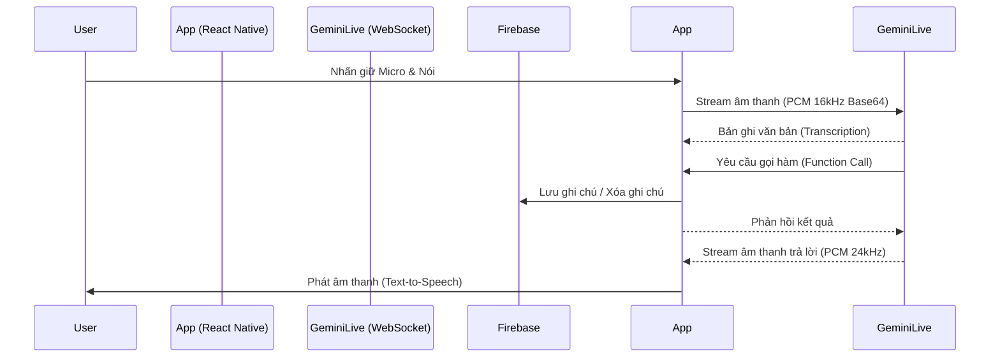

# 🤖 AI Reminder Assistant - Trợ lý Ảo AI Thông Minh


**AI Reminder Assistant** là một ứng dụng quản lý công việc và nhắc việc thế hệ mới, kết hợp sức mạnh của **Trí tuệ Nhân tạo (Gemini Live API)** và **Giao diện Lịch biểu Thông minh (Smart Timeline)**. Ứng dụng cho phép người dùng tương tác với trợ lý ảo bằng giọng nói thời gian thực (Real-time Voice AI), tự động trích xuất thông tin và tạo lịch nhắc việc một cách dễ dàng.

---

## 📑 Mục lục
- [Tính năng nổi bật](#-tính-năng-nổi-bật)
- [Kiến trúc & Công nghệ](#-kiến-trúc--công-nghệ)
- [Giao diện ứng dụng](#-giao-diện-ứng-dụng)
- [Cấu trúc thư mục](#-cấu-trúc-thư-mục)
- [Yêu cầu hệ thống](#-yêu-cầu-hệ-thống)
- [Hướng dẫn cài đặt & Chạy dự án](#-hướng-dẫn-cài-đặt--chạy-dự-án)
- [Giấy phép](#-giấy-phép)

---

## ✨ Tính năng nổi bật

| Tính năng | Mô tả chi tiết |
| :--- | :--- |
| 🎙️ **Voice AI Thời gian thực** | Giao tiếp với AI bằng giọng nói với độ trễ cực thấp nhờ giao thức WebSocket của **Gemini Live API**. Hỗ trợ phát hiện giọng nói (VAD) và tự động chuyển đổi giọng nói thành văn bản (Transcription). |
| 🧠 **Xử lý Đa ý định (Multi-intent)** | AI có khả năng hiểu và thực thi nhiều lệnh cùng lúc (VD: *"Nhắc tôi họp lúc 3h chiều và xóa ghi chú đi chợ"*). |
| 📅 **Smart Timeline (Lịch biểu)** | Tích hợp màn hình Lịch tháng trực quan. Các ngày có lịch hẹn sẽ được đánh dấu. Dễ dàng theo dõi công việc theo từng ngày. |
| 💬 **Trí nhớ Hội thoại** | Lưu trữ lịch sử chat thông minh, tự động gộp các đoạn văn bản nhỏ và tự động reset sau 30 phút để tránh quá tải ngữ cảnh. |
| ⚡ **Cơ chế Fallback (Dự phòng)** | Tự động chuyển đổi linh hoạt giữa các Model AI (Gemini/Groq) để đảm bảo ứng dụng không bao giờ bị gián đoạn khi server quá tải. |
| 🔒 **Bảo mật & Đồng bộ** | Dữ liệu ghi chú được đồng bộ hóa thời gian thực trên nền tảng đám mây (Firebase Firestore). API Key được bảo mật qua biến môi trường. |

---

## 🏗 Kiến trúc & Công nghệ

Dự án được xây dựng với kiến trúc hiện đại, tối ưu hóa cho trải nghiệm người dùng trên thiết bị di động.

**Công nghệ sử dụng:**
*   **Frontend:** React Native, Expo (SDK 58), Expo Router (Tabs/Stack).
*   **Ngôn ngữ:** TypeScript.
*   **AI & Xử lý âm thanh:** Gemini Live API (WebSocket), `@siteed/audio-studio` (ghi âm PCM), `expo-audio` (phát âm thanh).
*   **Backend & Cơ sở dữ liệu:** Firebase Firestore, AsyncStorage (lưu trữ cục bộ).
*   **Build Tool:** EAS Build (Expo Application Services).

**Luồng hoạt động của Voice AI:**


---

## 📸 Giao diện ứng dụng

*(Lưu ý: Thay thế các đường link ảnh dưới đây bằng ảnh chụp màn hình thực tế của bạn)*

| Màn hình Ghi chú | Màn hình Lịch biểu | Giao diện Chat AI |
| :---: | :---: | :---: |
|  |  |  |

---

## 📂 Cấu trúc thư mục

```text
AiReminderApp/
├── app.json                 # Cấu hình Expo & Quyền Native
├── eas.json                 # Cấu hình EAS Build
├── src/
│   ├── app/                 # Expo Router (Điều hướng)
│   │   ├── (tabs)/          # Thanh Bottom Tabs
│   │   │   ├── index.tsx    # Tab Ghi chú
│   │   │   ├── calendar.tsx # Tab Lịch biểu
│   │   │   └── chat.tsx     # Tab Chat AI (Voice)
│   │   ├── add-note.tsx     # Modal Thêm/Sửa ghi chú
│   │   └── _layout.tsx      # Layout gốc
│   ├── components/          # Các UI Components dùng chung
│   ├── services/            # Xử lý logic API
│   │   ├── geminiService.ts # Gọi API Text (REST)
│   │   └── liveSocketService.ts # Xử lý WebSocket Live API (Voice)
│   ├── storage/             # Lưu trữ dữ liệu (Firebase & AsyncStorage)
│   ├── theme/               # Quản lý màu sắc, typography
│   ├── types/               # Định nghĩa Interfaces TypeScript
│   └── utils/               # Các hàm tiện ích
└── package.json
```

---

## ⚙️ Yêu cầu hệ thống

Trước khi chạy dự án, hãy đảm bảo máy tính của bạn đã cài đặt:
*   **Node.js** (phiên bản 18 trở lên)
*   **Git**
*   **Android Studio** (nếu chạy máy ảo Android)
*   Tài khoản **Expo** (để chạy EAS Build)
*   Tài khoản **Firebase** (để tạo Project Firestore)
*   **Google AI Studio API Key** (để lấy Gemini API Key)

---

## 🚀 Hướng dẫn cài đặt & Chạy dự án

**Bước 1: Clone dự án**
```bash
git clone https://github.com/txhiuu/ai-reminder-assistant.git
cd ai-reminder-assistant
```

**Bước 2: Cài đặt thư viện**
```bash
npm install
```

**Bước 3: Cấu hình biến môi trường**
Tạo một file `.env` ở thư mục gốc của dự án và thêm các khóa API của bạn:
```env
EXPO_PUBLIC_GEMINI_API_KEY=your_gemini_api_key_here
```

**Bước 4: Cấu hình Firebase**
Thay thế thông tin cấu hình Firebase của bạn trong file `src/config/firebase.ts`.

**Bước 5: Chạy ứng dụng (Development Build)**
*Lưu ý: Vì dự án sử dụng các thư viện Native xử lý âm thanh (`@siteed/audio-studio`), bạn không thể chạy bằng Expo Go. Bạn phải tạo Development Build.*

```bash
# Đăng nhập Expo
eas login

# Tạo bản build cho Android (hoặc iOS)
eas build --profile development --platform android

# Sau khi tải file APK về máy và cài đặt, chạy server code:
npx expo start --dev-client
```

---

## 🤝 Đóng góp
Mọi đóng góp, báo lỗi (issues) hoặc yêu cầu tính năng mới đều được hoan nghênh. Hãy tạo Pull Request hoặc mở Issue trên GitHub.

## 📝 Giấy phép
Dự án này được phân phối dưới giấy phép **MIT License**. Xem file `LICENSE` để biết thêm chi tiết.

---
*Được phát triển với ❤️ bởi txhiuu*
